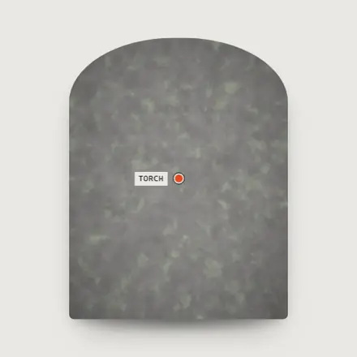
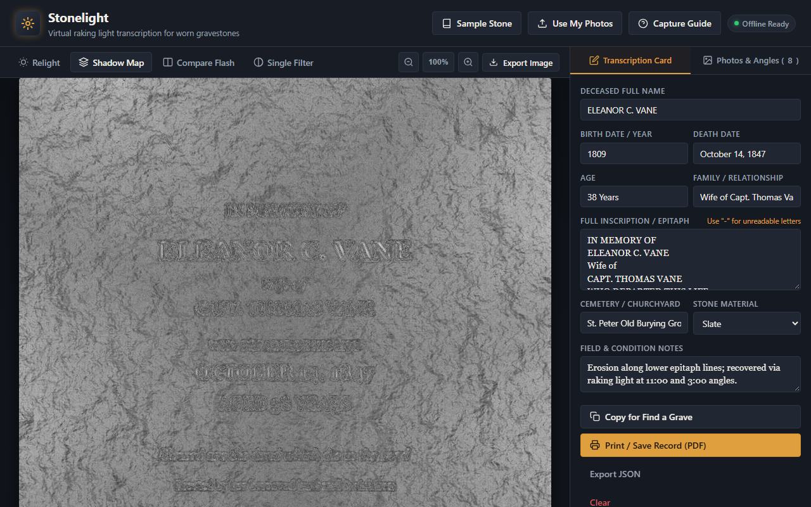
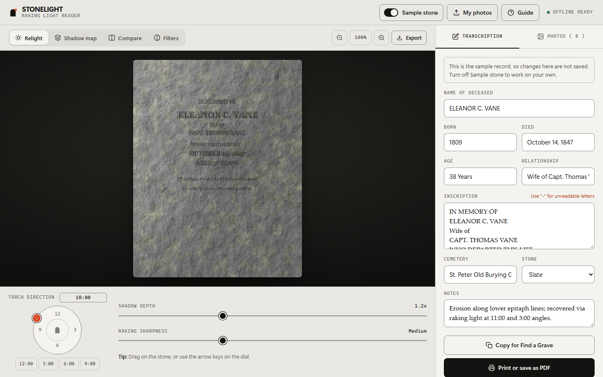
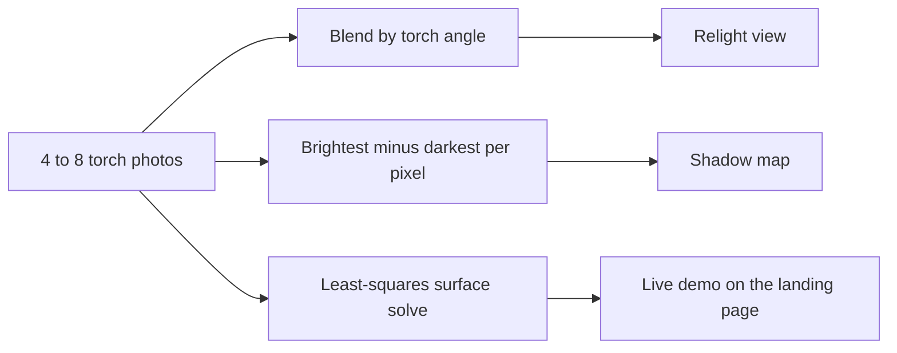

<p align="center">
  
</p>

<h1 align="center">Stonelight</h1>

<p align="center">
  <b>Read worn gravestones in your browser.</b><br>
  A few phone-torch photos become a light you can move, so the carving casts shadows again.
</p>

<p align="center">
  <a href="https://zghanw.github.io/stonelight/"><b>Live site</b></a>
  &nbsp;·&nbsp;
  <a href="https://zghanw.github.io/stonelight/app.html"><b>Open the app</b></a>
  &nbsp;·&nbsp;
  <a href="#how-it-works">How it works</a>
  &nbsp;·&nbsp;
  <a href="#run-it-locally">Run it locally</a>
</p>

<p align="center">
  <sub>1st place, Web Dev Open Track (Ages 18+), <a href="https://digital-coding-competition.netlify.app/2026">International Digital Coding Competition 2026</a></sub>
</p>

<p align="center">
  
</p>

<p align="center">
  <sub>The same eight photos throughout. Only the light moves.</sub>
</p>

<p align="center">
  <sub>No physical contact · No shaving cream · No tripod or RAW camera · Nothing uploaded · Works offline</sub>
</p>

<table>
  <tr>
    <td width="50%"></td>
    <td width="50%"></td>
  </tr>
  <tr>
    <td align="center"><sub>The landing page: your cursor is the torch</sub></td>
    <td align="center"><sub>The app: relight, compare and transcribe</sub></td>
  </tr>
</table>

---

## Why

Gravestones erode until their inscriptions can no longer be read in flat daylight, and a camera flash washes out the shallow shadows that make letters visible. People who need to read them often end up doing one of these:

- Smearing shaving cream, chalk or flour on the stone, which speeds up its decay.
- Posting a photo online and asking strangers to enhance it.
- Attempting laboratory RTI, which needs reflective spheres, a tripod, a DSLR and desktop software.

The Association for Gravestone Studies recommends raking light and digital processing over anything that touches the stone. Stonelight puts that method in a browser tab, for anyone with a phone and a torch.

## Who it is for

| | |
| --- | --- |
| **Family historians** | One name and two dates, read correctly, without waiting on a forum. |
| **Find a Grave volunteers** | A repeatable way to read a stone, and a transcription ready to paste. |
| **Preservation groups** | A method that never touches the stone, with a printable record for every marker. |

## What it does

| Feature | What you get |
| --- | --- |
| **Relight** | Drag across the stone, or turn the torch dial, to move a virtual raking light around the carving. |
| **Shadow map** | Every angle combined into one image, as a chisel relief, a slate rubbing or a variance map. |
| **Compare** | A slider between the flat flash photo and the relit view. |
| **Filters** | Invert, emboss, high-pass and contrast, for when you only have one photo. |
| **Transcription card** | Name, dates, inscription and notes, with `-` for letters that are gone. Saved on your device. |
| **Copy and print** | One click copies the record for Find a Grave. Print it, or save it as a PDF with both stone images. |
| **Your own photos** | Drop in 4 to 8 photos. Torch angles are estimated for you and can be corrected on a clock face. |
| **Capture guide** | How to prop the phone, lock exposure and sweep the torch at the stone. |
| **Sample stone** | A simulated 1847 slate headstone you can switch on or off. Your own photos and transcription are kept separately. |
| **Offline and private** | Installs as an app and runs with no connection. No tracking, no accounts, no uploads. |

## How it works



**Relight.** Each photo is tagged with the clock position of the torch. When you move the virtual light, Stonelight weights every photo by the cosine of the angle between it and your light, then blends the pixels in typed arrays on a canvas. Exposure is corrected automatically, so dark torch photos stay readable.

**Shadow map.** For every pixel, Stonelight measures how much its brightness changes across all the photos. Carved strokes swing between lit and shadowed, while flat stone barely changes, so the difference isolates the inscription from the grain.

**Landing page demo.** The hero goes one step further. It solves a slope for every pixel from the eight sample photos by least squares (photometric stereo), then shades that surface from wherever your cursor is:

```text
I = L · g
g = (LᵀL)⁻¹ Lᵀ I
shade = 1 + (g · d) × rake
```

Hold the light head-on and the stone goes flat, exactly like a flash photo. Lower it to the side and the inscription appears.

## Two-minute tour

1. **See the problem.** Open the app and choose **Compare**. The flash photo on the left is hard to read.
2. **Move the light.** Choose **Relight** and drag across the stone, or use the arrow keys on the torch dial.
3. **See every angle at once.** Choose **Shadow map** and switch between **Chisel relief** and **Slate rubbing**.
4. **Record it.** Fill in the **Transcription** tab, then choose **Print or save as PDF**.
5. **Go offline.** Turn on airplane mode and reload. It still works, and nothing was uploaded.

## Run it locally

Stonelight is plain HTML, CSS and JavaScript. There is no build step and nothing to install.

```bash
python -m http.server 8000
```

Then open `http://localhost:8000`. Any static file server works, for example `npx serve .`.

## Project layout

```text
index.html        Landing page
app.html          The app
css/              base.css, landing.css, app.css
js/relight.js     Angle-weighted relighting and single-photo filters
js/shadowmap.js   Chisel relief, slate rubbing and variance maps
js/transcribe.js  Transcription card, copy, print and export
js/guide.js       Capture guide and clock picker dialogs
js/landing.js     Surface solve and the live demo
sample/           The simulated sample stone
sw.js             Offline cache
```

## Ethics

Stonelight follows the conservation guidance of the Association for Gravestone Studies:

- Never apply shaving cream, chalk, flour, detergents or other chemicals to a stone.
- Never use wire brushes or scrapers.
- Ask the church or cemetery before you photograph.

## Built with

- **Platform:** Canvas 2D, typed arrays, Pointer Events, Service Worker and a Web App Manifest. No frameworks and no external requests.
- **Accessibility:** keyboard control for the torch dial, visible focus, focus-trapped dialogs and reduced-motion support.
- **Privacy:** no tracking, no analytics, and photos never leave your device.

<p align="center">
  <sub>No tracking. No accounts. No uploads.</sub>
</p>
